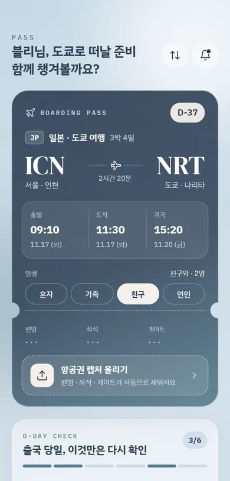
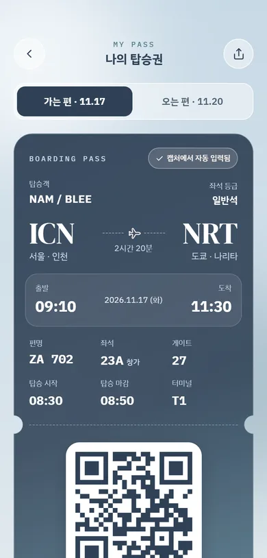
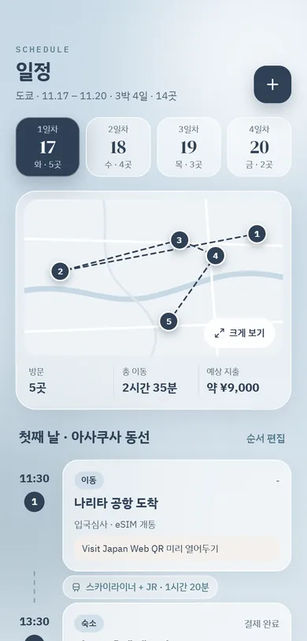
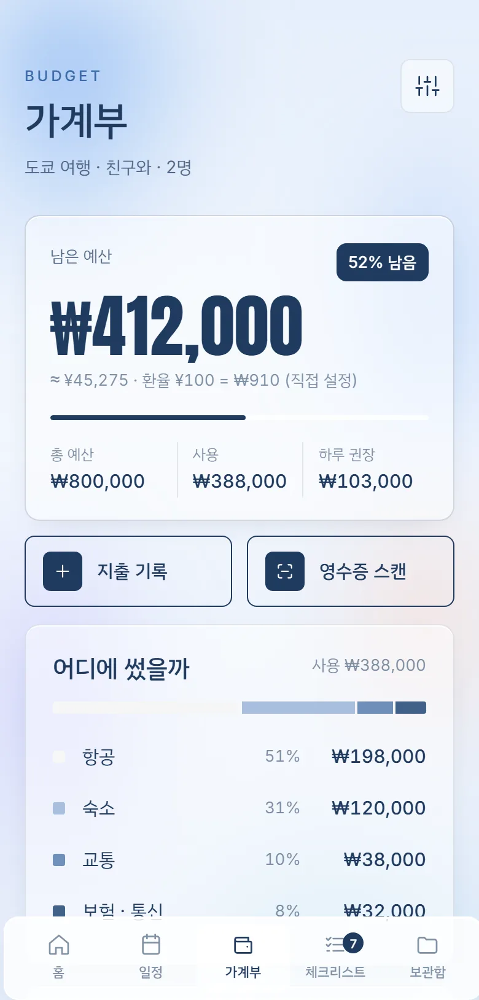
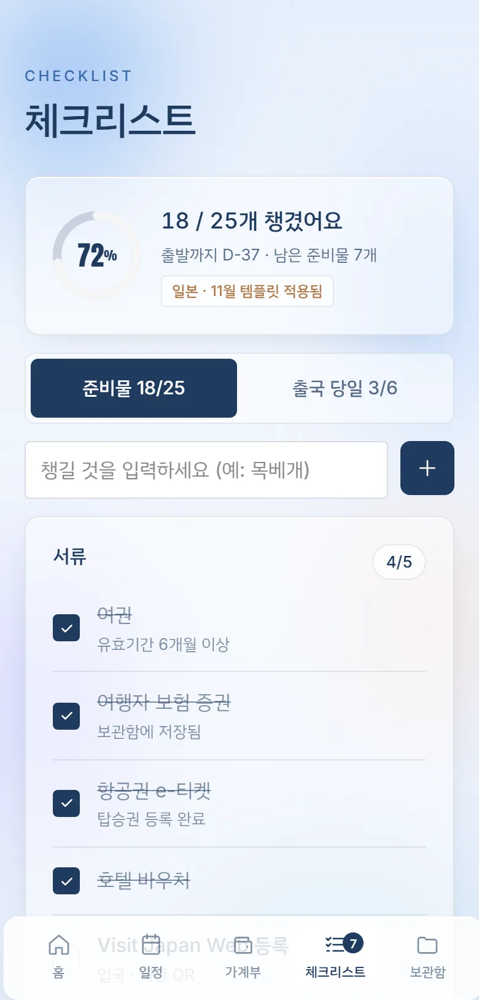
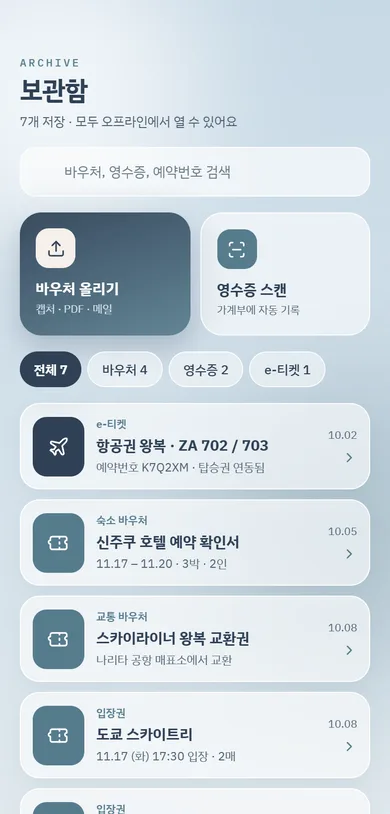
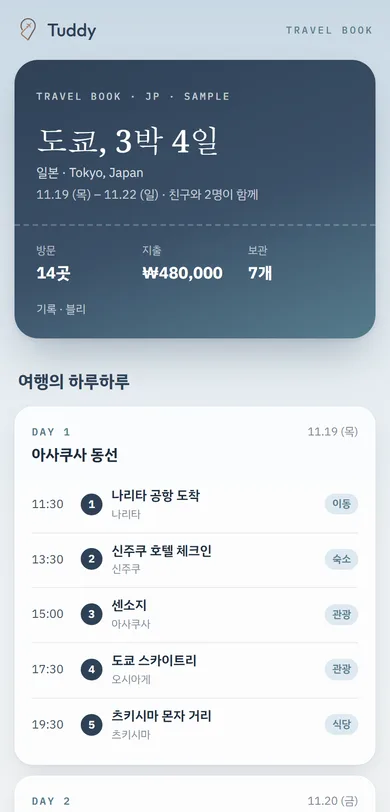
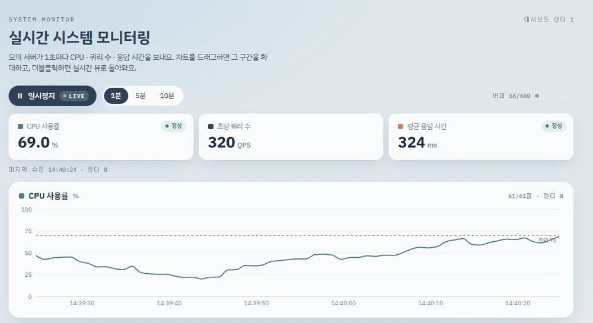
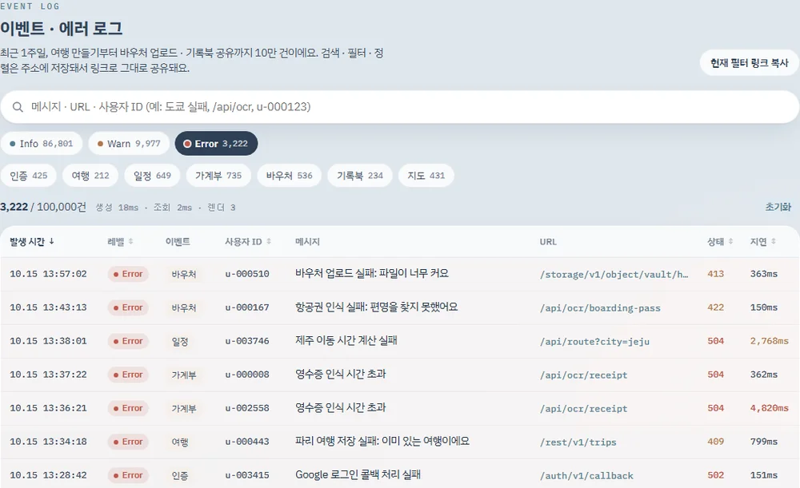

<div align="center">


# Tuddy (터디) — 나의 여행 버디

여행 준비물부터 탑승권 · 일정 · 가계부 · 바우처 보관까지 한 곳에서 챙기는 **모바일 여행 앱**

*기록의 번거로움은 줄이고, 여행의 순간에 집중하게 한다.*

[](https://github.com/Roohyeon/tuddy/actions/workflows/ci.yml)
[](https://tuddy-gold.vercel.app)


**[🔗 배포 사이트](https://tuddy-gold.vercel.app)** · [샘플 여행 기록북](https://tuddy-gold.vercel.app/book/tokyo-4days) · [실시간 모니터링](https://tuddy-gold.vercel.app/monitor)

<sub>로그인 화면에서 <b>데모 여행으로 둘러보기</b>를 누르면 가입 없이 샘플 여행으로 바로 써 볼 수 있어요.</sub>

</div>

<br />

## 화면

<table>
  <tr>
    <td align="center"><br /><b>홈</b><br /><sub>탑승권 카드 · 출국 당일 체크</sub></td>
    <td align="center"><br /><b>나의 탑승권</b><br /><sub>캡처 인식 · QR · 공항 타임라인</sub></td>
    <td align="center"><br /><b>일정</b><br /><sub>지도 위 번호 핀 · 동선</sub></td>
    <td align="center"><br /><b>가계부</b><br /><sub>남은 예산 · 환율 · 카테고리</sub></td>
  </tr>
  <tr>
    <td align="center"><br /><b>체크리스트</b><br /><sub>여행지 · 계절 맞춤 준비물</sub></td>
    <td align="center"><br /><b>보관함</b><br /><sub>유리 폴더 · 바우처 · 영수증</sub></td>
    <td align="center"><br /><b>공유 기록북</b><br /><sub>로그인 없이 링크로 (SSR/SSG)</sub></td>
    <td align="center" valign="middle"><sub>디자인</sub><br /><b>Light Glass<br />Sky Blue · Navy Ink</b><br /><br /><sub>옅은 하늘빛 캔버스 위<br />서리 유리 카드<br />+ 펀칭된 탑승권<br />+ 하단 플로팅 탭바</sub></td>
  </tr>
</table>



<p align="center"><sub><b>/monitor</b> — 1초마다 들어오는 지표를 실시간 차트로, 10만 건 로그를 가상화 테이블로 보여 주는 대시보드</sub></p>

## 이 프로젝트에서 보여 주는 것

| | 핵심 | 자세히 |
| --- | --- | --- |
| 🧭 | **페이지 성격에 맞춘 렌더링** — 공유 기록북은 SSG/SSR(SNS 미리보기 · SEO), 앱 화면은 CSR | [렌더링 전략](#렌더링-전략) |
| 🗂 | **서버 상태 / 클라이언트 상태 분리** — TanStack Query + Zustand, 바뀐 행만 저장하는 낙관적 업데이트 | [상태 관리](#상태-관리) |
| 📈 | **느려지지 않는 실시간 화면** — 외부 스토어 + rAF 배치, 10만 행 가상화. 실측: 1초 틱에 대시보드 렌더 **0회**, 스크롤 중 차트 렌더 **0회** | [실시간 모니터링](#실시간-시스템-모니터링-monitor) |
| 🔐 | **안전한 AI 연동** — Claude Vision 서버 프록시: 키는 서버에만, 로그인 · 하루 제한(429) · 이미지 해시 캐시 | [항공권 캡처 인식](#항공권-캡처-인식-claude-vision--서버-프록시) |
| 🛡 | **DB 수준 보안** — 모든 테이블 RLS, 남의 여행에 행을 끼워 넣는 경로까지 차단 | [Supabase 설정](#supabase-설정) |
| ✅ | **검증 · 측정** — 단위 261개 · E2E 17개, CI 통과해야 병합, Lighthouse · 렌더 횟수 실측 기록 | [테스트 · CI/CD](#테스트--cicd) |

## 기술 스택

| 영역 | 사용 기술 |
| --- | --- |
| 프레임워크 | **Next.js 16** (App Router, Turbopack) · **React 19** · **TypeScript 5.9** (`strict`) |
| 렌더링 | SSG(`generateStaticParams`, `opengraph-image`, `sitemap.ts`) · SSR(`generateMetadata`, Route Handler + `next/og`) · CSR(`'use client'`, 라우트 가드) |
| 상태 | **TanStack Query v5** (서버 상태) · **Zustand v5** (클라이언트 상태) |
| 백엔드 | **Supabase** — Auth(이메일 · Google · 익명), Postgres, RLS (`supabase/migrations`) |
| 데이터 시각화 | **Recharts 3** · **TanStack Table v8 + Virtual** |
| 폼 | react-hook-form + zod (어드민) |
| AI | **Claude API** (`@anthropic-ai/sdk`, Vision · 구조화 출력) — 서버 Route Handler에서만 호출 |
| 품질 · 배포 | ESLint · **Vitest** · **Playwright** · **GitHub Actions** CI · **Vercel** (Preview · Production) · Lighthouse |
| 외부 API | Google 지도 임베드 · OpenStreetMap Nominatim · open.er-api 환율 |

## 주요 기능

| 화면 | 주요 기능 |
| --- | --- |
| **로그인 / 회원가입** | Supabase Auth 이메일 가입 · 로그인(메일 인증), Google 로그인, 로그인 상태 유지, 데모 여행으로 둘러보기(익명 로그인) |
| **새 여행 만들기** | 37개 나라 · 80개 도시 검색(도시 · 나라 · 영문 · 공항 코드) → 날짜 · 동행 → 예산. 여행지 · 계절(남반구 포함) · 일수에 맞춰 준비물/출국 체크리스트, 비자 · ETA, 콘센트, 통화 자동 설정 |
| **홈 (PASS)** | 탑승권 카드(D-Day, 동행 선택, 여행 날짜 변경), 항공권 캡처 → 편명 · 좌석 · 게이트 자동 입력, 출국 당일 체크, 준비 현황, 빠른 추가, 일자별 동선 |
| **나의 탑승권** | 가는 편/오는 편, QR, 정보 수정, 출국 당일 공항 타임라인, 알림 토글, 공유 |
| **일정** | 일자 탭, Google 지도 위 번호 핀 + 점선 동선(멀리 떨어진 곳은 가장자리에 거리 표시), 크게 보기 · 실제 경로, 앱에서 길찾기, 장소 좌표 자동 검색, 이동 시간 자동 계산, 순서 편집 |
| **가계부** | 남은 예산 · 환율 환산, 원화/현지 통화 입력, 카테고리 차트, 하루 권장 예산 대비 일자별 지출, 영수증 스캔(데모: 예시 값), 실시간 환율 |
| **체크리스트** | 진행률, 준비물/출국 당일 탭, 입력하면 분류 자동 추천, 체크 · 삭제(되돌리기) |
| **보관함** | 전체 · 바우처 · e-티켓 · 영수증 유리 폴더(누르면 파일이 솟아오르고 그 분류로 필터), 검색, 바우처(이미지 · PDF) 업로드 및 일정 연결, 영수증 스캔 → 가계부 자동 기록(데모: 예시 값), 오프라인 열람, 여행 기록북 미리보기 · 공유 링크 |
| **공유용 여행 기록북** | 로그인 없이 링크로 보는 여행 요약 — 표지, 일자별 동선, 카테고리별 지출, SNS 미리보기 이미지 (SSR/SSG) |
| **실시간 모니터링** | `/monitor` — 지표 3종 실시간 차트(일시정지 · 드래그 확대 · 구간 이동), 10만 건 이벤트 · 에러 로그 검색 · 필터 · 정렬(URL로 공유) |
| **여행지 관리 (어드민)** | `/admin` — 80개 도시 카탈로그 검색 · 필터 · 정렬, 모달 폼 등록 · 수정 · 삭제. react-hook-form + zod 검증, 낙관적 업데이트(실패한 항목만 되돌림), 동시 수정 충돌 감지. 관리자만(DB RLS) |

<br />

## 렌더링 전략
**페이지의 성격에 따라 렌더링 방식을 나눴어요.** 누구나 링크로 여는 *공유용 여행 기록북*은 서버에서 HTML을 완성해 보내고(SSR/SSG), 로그인한 사용자가 계속 조작하는 *앱 화면*은 브라우저에서 그려요(CSR).

| 구분 | 경로 | 방식 | 빌드 결과 |
| --- | --- | --- | --- |
| 샘플 여행 기록북 | `/book/tokyo-4days`, `/book/osaka-3days` | **SSG**: `generateStaticParams`로 빌드할 때 HTML 생성, `dynamicParams = false` | ● SSG |
| 샘플 기록북 OG 이미지 | `/book/[slug]/opengraph-image` | **SSG**: 빌드할 때 PNG 생성 | ● SSG |
| 공유 링크 기록북 | `/book/share?d=…` | **SSR**: 요청마다 링크 데이터를 검증한 뒤 HTML과 메타 태그 생성 | ƒ Dynamic |
| 공유 링크 OG 이미지 | `/book/share/og?d=…` | **SSR**: Route Handler에서 `ImageResponse`로 생성 | ƒ Dynamic |
| sitemap | `/sitemap.xml` | 정적 생성 (샘플 기록북만 포함) | ○ Static |
| 실시간 모니터링 | `/monitor` | **CSR**: 정적 껍데기 + 브라우저에서 모의 데이터 생성 · 차트 렌더링 | ○ Static 껍데기 + CSR |
| 여행지 관리 (어드민) | `/admin` | **CSR**: 관리자 로그인 후 브라우저가 Supabase `destinations` 테이블을 읽고 써요 | ○ Static 껍데기 + CSR |
| 항공권 인식 API | `/api/ticket-scan` | **Route Handler**: 서버에서만 Claude 호출 | ƒ Dynamic |
| 앱 화면 | `/login` `/onboarding` `/home` `/schedule` `/budget` `/packing` `/vault` `/pass` | **CSR**: 빈 껍데기만 정적으로 받고, 데이터는 브라우저가 Supabase에서 받아 그림 | ○ Static 껍데기 + CSR |

<details>
<summary><b>공유용 여행 기록북에 SSR/SSG를 적용한 이유</b></summary>

- **SNS 공유 미리보기**: 카카오톡 · 슬랙 · X · 페이스북의 링크 미리보기 봇은 대부분 JavaScript를 실행하지 않아요. CSR로 만들면 봇에게는 빈 `<div>`만 보여서 제목 · 설명 · 썸네일이 비게 돼요. 서버에서 `og:title` · `og:description` · `og:image` · `twitter:card`를 HTML에 넣어 보내야 미리보기 카드가 제대로 나와요. 썸네일도 `next/og`로 여행지 · 날짜 · 방문 수를 담은 1200×630 이미지를 서버에서 만들어요.
- **SEO 최적화**: 검색엔진이 받는 첫 HTML에 일정 · 장소 · 지출 내용이 모두 들어 있어서 그대로 색인돼요. 정적 샘플 기록북은 `canonical`과 `sitemap.xml`까지 갖춰 검색 노출용 페이지로 써요.
- **빠른 초기 로딩**: 기록북은 읽기만 하는 페이지라 서버 컴포넌트로만 만들었어요(`TravelBookView`, `'use client'` 없음). 이 페이지를 위한 클라이언트 JavaScript가 거의 없고, JavaScript가 꺼져 있어도 내용이 보여요.
- **SSG와 SSR을 나눈 기준**
  - **SSG (샘플 기록북)**: 내용이 바뀌지 않으니 빌드할 때 한 번만 만들어 CDN에서 캐시된 파일로 내려줘요(`x-nextjs-cache: HIT`). 서버 비용이 들지 않고 가장 빨라요.
  - **SSR (공유 링크)**: 사용자마다 내용이 달라 미리 만들 수 없어요. 요청 시점에 링크(`?d=`)의 데이터를 서버가 읽어 HTML과 OG 태그를 만들어요.
- **공유 데이터를 다루는 방식**
  - 서버 DB 없이 공개해도 되는 요약만 base64url JSON으로 링크에 담아요. 예약번호 · 탑승객 이름 · 첨부 파일 · 메모는 넣지 않아요.
  - 서버는 링크 값을 믿지 않고 `decodeBook()`에서 타입 · 길이 · 날짜 범위를 하나씩 검사하고, 잘못된 링크는 404로 처리해요.
  - 개인 여행이라 공유 링크 페이지는 `noindex`로 검색에서 빼요. SNS 미리보기는 OG 태그로 정상적으로 나와요.

</details>

<details>
<summary><b>앱 화면에 CSR을 적용한 이유</b></summary>

- **사용자 인터랙션이 많아요**: 체크 토글, 바텀 시트, 순서 편집, 되돌리기 토스트, 지도 핀 선택, 일차 탭 전환처럼 화면을 바꾸는 조작이 매우 잦아요. 조작마다 서버를 거치면 반응이 느려지니, 브라우저에서 바로 상태를 바꾸고 다시 그려요.
- **클라이언트 상태 관리**: 계정과 여행 데이터는 로그인한 사용자의 토큰으로 브라우저가 Supabase에서 직접 읽고 써요. 개인 데이터라 검색 노출이 필요 없고, 낙관적 업데이트로 바로 반영하는 편이 체감 속도가 좋아요.
- **동적 데이터 처리**: 실시간 환율(open.er-api), 장소 좌표 검색(Nominatim), 지도 크기에 맞춘 핀 위치 계산(`ResizeObserver`), 이미지 축소(Canvas · FileReader), Web Share · 클립보드 API처럼 브라우저에서만 할 수 있는 처리가 대부분이에요.
- **검색 노출이 필요 없어요**: 로그인한 사람만 보는 개인 대시보드라 `(app)` 레이아웃에 `noindex`를 걸어 두었어요.
- **동작 방식**: 앱 경로도 빌드 결과는 ○ Static이지만, 서버가 내려주는 건 데이터 없는 껍데기(기기 프레임 · 스플래시)뿐이에요. `Guard`가 Supabase 세션과 계정 데이터를 확인한 뒤 `/login` · `/onboarding` · `/home`으로 보내고 화면을 그려요. 그래서 정적 호스팅이나 CDN만으로 배포할 수 있어요.

</details>

<details>
<summary><b>프로젝트 구조</b></summary>

라우트 그룹으로 레이아웃을 나눠서 렌더링 방식이 섞이지 않게 했어요. 루트 `layout.tsx`는 html · 폰트 · 메타데이터만 담당하고, 클라이언트 Provider와 기기 프레임은 `(app)` 그룹에서만 감싸요. 그래서 `/book/*`는 클라이언트 번들 없이 서버에서 바로 렌더링돼요.

```
src/
├─ app/
│  ├─ layout.tsx                 # 공통: html · 폰트 · metadataBase (서버)
│  ├─ sitemap.ts                 # 샘플 기록북 sitemap
│  ├─ (app)/                     # ── CSR 영역 ──
│  │  ├─ layout.tsx              # QueryProvider + AppChrome(탭바 · 시트 · 토스트), noindex
│  │  ├─ page.tsx                # / → 로그인 · 새 여행 · 홈으로 분기
│  │  ├─ login/  onboarding/  admin/
│  │  └─ (trip)/                 # 여행이 있어야 들어오는 화면 (Guard)
│  │     └─ home/ schedule/ budget/ packing/ vault/ pass/
│  ├─ monitor/page.tsx           # 실시간 시스템 모니터링 (CSR)
│  ├─ api/ticket-scan/route.ts   # 항공권 인식 서버 프록시 (Claude)
│  └─ book/                      # ── SSR/SSG 영역 ──
│     ├─ [slug]/page.tsx         # SSG 샘플 기록북
│     ├─ [slug]/opengraph-image.tsx
│     └─ share/page.tsx          # SSR 공유 링크 기록북
│        └─ og/route.tsx         # SSR OG 이미지
├─ api/                          # 데이터 접근 계층 (컴포넌트는 직접 부르지 않음)
│  ├─ account.ts                 # Supabase: 계정 조회 · 변경분 저장 · 로그인 · 회원가입 · 데모
│  ├─ rows.ts                    # UserDB ↔ 테이블 행 변환, 변경분(diff) 계산
│  ├─ external.ts                # 지오코딩 · 실시간 환율 fetch
│  └─ ticketScan.ts              # 브라우저 → /api/ticket-scan 호출
├─ queries/                      # TanStack Query 훅 (서버 상태)
├─ stores/                       # Zustand 스토어: session · ui · sheet · toast
├─ components/
│  ├─ book/                      # TravelBookView (서버 컴포넌트)
│  ├─ monitor/                   # MonitorDashboard · MetricChart · LiveStats · LogExplorer · LogTable
│  ├─ screens/  sheets/  ui/     # 앱 화면 · 바텀 시트 · 공용 조각
├─ lib/
│  ├─ server/                    # 서버 전용: Claude 호출 · 하루 제한 (server-only)
│  ├─ monitor/                   # 모의 지표 스트림 · 원형 버퍼 · LTTB · 10만 행 로그 · 쿼리
│  ├─ supabase/                  # 브라우저 클라이언트 · 테이블 타입
│  └─ book · trip · map · files · utils · destinations
└─ types/domain.ts               # 도메인 타입 (Trip · TravelBook …)
supabase/migrations/             # 테이블 · RLS · 가입 트리거 SQL
perf/                            # Lighthouse · 렌더 횟수 측정 스크립트와 기록
e2e/                             # Playwright E2E
```
이전 Vanilla JS 버전은 `legacy/`에 그대로 보관했어요.

</details>

## 상태 관리
예전에는 `TuddyProvider`(React Context) 하나가 계정 데이터, 저장, 화면 선택 값, 시트, 토스트를 모두 들고 있어서 값 하나만 바뀌어도 앱 전체가 다시 그려졌어요. 지금은 **역할에 따라 나눴어요.**

| 구분 | 담당 | 기준 | 예 |
| --- | --- | --- | --- |
| 서버 상태 | **TanStack Query** | Supabase나 외부 API에 원본이 있고, 불러오기 · 저장 · 로딩 · 에러 · 캐시가 필요한 값 | 계정 · 여행 데이터, 로그인 결과, 실시간 환율, 장소 좌표 |
| 클라이언트 상태 | **Zustand** | 이 브라우저 화면에서만 의미 있고 저장하지 않아도 되는 값 | 로그인 세션, 선택한 일차 · 탭 · 탑승권 방향, 열린 시트, 토스트 |
| 지역 상태 | `useState` | 한 컴포넌트 안에서만 쓰는 값 | 폼 입력값, 순서 편집 모드 |

```
Supabase Auth ──onAuthStateChange──▶ Zustand useSessionStore(user)
                                            │
컴포넌트 ──useAccount()/useTrip()──▶ useQuery(['account', user.id]) ──▶ api/account.fetchAccount
    │                                                                    (profiles + trips + 하위 5개 테이블)
    └─update(db => …)──▶ ① 캐시를 복사해 고친 값으로 바로 교체 (낙관적 업데이트, 화면 즉시 반영)
                         ② useMutation(scope: 'account') ──▶ api/account.saveAccount
                            → 이전 값과 비교해 바뀐 행만 upsert / delete
                         ③ 실패 → 토스트 + 서버 값으로 다시 맞춤(invalidate) · Promise<false>
```

- **필요한 것만 구독**: 데이터는 `useTrip()` · `useUpdateAccount()`, 화면 값은 `useUIStore(s => s.sday)`처럼 필요한 필드만 구독해요. 시트를 열고 닫아도 데이터 화면은 다시 그려지지 않아요.
- **컴포넌트는 Supabase를 몰라요**: 화면은 `update(db => …)`로 UserDB를 고치기만 하고, `api/rows.ts`가 이전 값과 비교해 **바뀐 행만** DB에 보내요. 준비물 하나를 체크하면 `packing_items` 1행만 upsert돼요.
- **저장은 순서대로**: 같은 `scope`의 뮤테이션은 줄을 서서 실행돼서, 빠르게 여러 번 바꿔도 마지막 상태가 저장돼요.
- **시트가 닫혀도 끝까지**: 좌표 찾기처럼 시트를 닫은 뒤 끝나는 작업은 결과 처리를 `useMutation` 옵션에 두어, 컴포넌트가 사라져도 결과가 저장돼요.

## 실시간 시스템 모니터링 (`/monitor`)
1초마다 들어오는 시스템 지표(CPU 사용률 · 초당 쿼리 수 · 평균 응답 시간)를 실시간 차트로, 10만 건 이벤트 · 에러 로그를 검색 가능한 테이블로 보여 줘요. **데이터가 계속 쌓여도 느려지지 않는 시각화**와 **리렌더 범위를 좁히는 상태 관리**를 보여 주려고 만들었어요.



| 기능 | 동작 |
| --- | --- |
| 모의 서버 | 브라우저 안에서 1초마다 지표 생성. CPU는 약 90초 주기 부하를 따라가는 평균 회귀 랜덤 워크 + 가끔 스파이크, 쿼리 수 · 응답 시간은 CPU와 연동 |
| 차트 | 지표별 선형 차트, 고정 y축, '주의' 기준선, 호버 툴팁 |
| 일시정지 · 확대 | 일시정지/재개(끊긴 구간 표시), 드래그로 세 차트 동시 확대, ‹ › 구간 이동, 보기 범위 1분 · 5분 · 10분 |
| 로그 탐색기 | 10만 행 검색 · 레벨/타입 필터 · 정렬(조회 2~4ms), 상태를 **URL 쿼리와 동기화** → 새로고침 · 공유 링크로 같은 화면 |

### 성능 최적화
| 문제 | 해결 |
| --- | --- |
| 데이터가 끝없이 쌓여 메모리가 늘어나요 | **고정 크기 원형 버퍼**에 최근 600개(10분)만 보관. 가득 차면 덮어써서 추가가 항상 O(1) |
| 보기 범위가 넓으면 SVG 점이 너무 많아요 | 보이는 구간만 **이진 탐색**으로 자르고, 300개가 넘으면 **LTTB**로 줄여요. 선 모양 · 스파이크는 그대로 |
| 렌더링이 데이터 생성 주기에 끌려가요 | 버퍼에는 바로 넣고, 구독자 알림은 **`requestAnimationFrame`에 한 번**으로 묶어요. 탭이 숨겨지면 rAF가 멈춰 렌더링도 쉬어요 |
| 10만 행을 그리면 DOM이 터져요 | **TanStack Virtual**로 보이는 행만 그리고, Table에는 전체가 아닌 보이는 30여 행만 넘겨요. 필터 · 정렬은 행 번호 배열(`Uint32Array`)로 끝내요 |
| 애니메이션을 켜면 매초 선 전체가 출렁여요 | 보간 애니메이션을 끄고 고정 y축 + 데이터와 함께 흘러가는 x축 눈금으로 끊김 없이 보이게 했어요 |

### 리렌더 최적화
1초마다 바뀌는 데이터를 React state에 두면 대시보드 전체가 매초 다시 그려져요. 그래서 데이터는 React 바깥의 **외부 스토어**(`MetricStream`)에 두고, 각 컴포넌트가 `useSyncExternalStore`로 **필요한 조각만** 구독해요.

```
MetricStream (외부 스토어 · 원형 버퍼)
   │  rAF로 프레임당 한 번 notify
   ├─▶ LiveStats      : snapshot.latest          (최신 값만)
   ├─▶ MetricChart ×3 : 보이는 구간 slice        (얕은 비교로 같으면 이전 참조 유지)
   ├─▶ BufferMeter    : snapshot.points.length   (가득 찬 뒤엔 리렌더 없음)
   └─▶ PauseButton    : snapshot.paused
MonitorDashboard : 보기 범위 · 확대 구간만 useState → 1초 틱에 리렌더 0회
```

- `useStreamSelector(stream, select, isEqual)`: 선택 결과가 같으면 이전 참조를 돌려줘서 리렌더를 건너뛰어요. **확대 중에는 새 데이터가 들어와도 보이는 구간이 그대로라 차트를 다시 그리지 않아요.**
- 자식은 `React.memo`, 콜백은 `useCallback`, 다운샘플링 · 축 범위 · 눈금은 `useMemo`로 고정했어요.
- 각 카드에 **렌더 횟수**를 표시해요. 카운터는 state 없이 `useEffect`에서 DOM에 바로 써서, 카운터 자체가 리렌더를 만들지 않아요.

#### 상황별 렌더 횟수 (실측)

<sub>측정: `node perf/render-counts.mjs` · 프로덕션 빌드 · Chromium headless 1280×900 · 3회 · 2026-10-15. 화면의 렌더 카운터를 시나리오 전후로 읽은 증가량이에요. 클릭 · 입력 · 스크롤은 1초 틱 렌더가 섞이지 않게 <b>일시정지 상태</b>에서 쟀어요.</sub>

| 상황 | 측정 구간 | 대시보드 | 최신 값 타일 | 차트 (1개당) | 로그 탐색기 | 로그 테이블 |
| --- | --- | --- | --- | --- | --- | --- |
| 첫 로드 | 마운트 + 백필 60개 | 1 | 2 | 2 ¹ | 2 | 2 |
| 실시간 수집 | 10초 (틱 10회) | **0** | 10 | 10 | **0** | **0** |
| 확대 중 (수집은 계속) | 10초 | **0** | 10 | **0** | **0** | **0** |
| 일시정지 | 10초 | 0 | 0 | 0 | 0 | 0 |
| 보기 구간 1분 → 5분 | 클릭 1회 | 1 | **0** | 1 | 1 ² | **0** |
| 로그 레벨 필터 칩 | 클릭 1회 | **0** | **0** | **0** | 1 | 2 |
| 검색어 입력 "도쿄 실패" | 5글자 입력 | **0** | **0** | **0** | 1~2 ³ | 2~4 |
| 10만 행 스크롤 (맨 끝까지) | 스크롤 300프레임 | **0** | **0** | **0** | **0** | 601 ⁴ |

<sub>¹ 마운트 1회 + 백필 60개 반영 1회 — 60개를 넣어도 rAF로 묶어서 한 번만 그려요<br />
² 로그 탐색기는 `memo`가 아니라서 대시보드가 다시 그려질 때 함께 그려져요. 그 아래 로그 테이블은 `memo`라 0회예요<br />
³ 글자마다 다시 그려지지 않고 250ms 디바운스 뒤에 검색해요. 입력 간격이 250ms를 넘으면 중간 검색이 한 번 더 일어나요 (3회 중 2회는 2 · 4, 1회는 1 · 2)<br />
⁴ 스크롤로는 로그 테이블만 그려지고(프레임당 약 2회) 차트 · 대시보드는 0회예요. 맨 끝에서도 DOM에 있는 행은 24개예요<br />
탭 숨김(rAF 정지)은 headless 브라우저에서 탭이 숨겨지지 않아(<code>visibilityState=visible</code>) 재지 못했어요</sub>

<details>
<summary><b>Core Web Vitals — 로그 탐색기 추가 전후</b> (LCP 4.66s · CLS 0.027 · TBT 94ms · INP 24ms)</summary>

측정: `node perf/measure.mjs` · Lighthouse 모바일 기본값(4× CPU · 느린 4G) · 로컬 프로덕션 빌드 · 5회 중앙값 · 2026-10-15 ([전체 기록](perf/RESULTS.md))

| 지표 | 기준(Good) | 추가 전 (`3-map-idle`) | 추가 후 (`4-log-explorer`) |
| --- | --- | --- | --- |
| LCP | ≤ 2.5s | 4.36s | 4.66s |
| CLS | ≤ 0.1 | 0.027 | 0.027 |
| TBT | ≤ 200ms | 196ms | 94ms |
| JS (같은 출처, 전송량) | | 244KB | 271KB |
| INP (필터 칩 클릭) | ≤ 200ms | — | **24ms** |

- 10만 건 로그 생성 · 조회는 첫 페인트 뒤(`requestAnimationFrame`)로 미뤄서 TBT가 늘지 않았어요(회차별 88~155ms. 196→94ms 감소는 측정 PC 부하에 따른 오차로 봐요). 로그 탐색기를 추가하면서 JS는 27KB 늘었어요.
- LCP 요소는 상단 소개 문구(`p.lede`)예요. 로컬 `next start`는 HTTP/1.1이라 LCP가 실제보다 길게 나와요. HTTP/2를 쓰는 Vercel Preview에서는 같은 페이지가 2.27s였어요(로그 탐색기 추가 전).
- INP는 Lighthouse로 잴 수 없어서 Chrome DevTools Live Metrics에서 4× CPU slowdown을 걸고 필터 칩을 5번 정도 직접 클릭해 쟀어요.

</details>

## 항공권 캡처 인식 (Claude Vision · 서버 프록시)
항공권 캡처를 올리면 서버(`POST /api/ticket-scan`)가 Claude(`claude-opus-5-5`)로 편명 · 시각 · 좌석 · 게이트 · 예약번호를 읽어 탑승권에 채워요. **브라우저는 우리 서버만 부르고, API 키 · Claude 호출은 서버에만 있어요.**

```
브라우저 ──(로그인 토큰 + 1600px JPEG)──▶ /api/ticket-scan
            ① 로그인 확인 → ② 크기 · 형식 검사 → ③ 캐시 → ④ 하루 제한 → ⑤ Claude (서버 전용 키)
```

| 위협 · 비용 | 막는 방법 |
| --- | --- |
| API 키 노출 | 키는 `ANTHROPIC_API_KEY`(`NEXT_PUBLIC_` 아님)로만 받고, 호출 모듈은 `import 'server-only'` — 클라이언트에서 import하면 빌드가 실패해요. 오류 응답에는 내부 메시지 없이 `code`만 보내요 |
| 아무나 호출 | Supabase 로그인 토큰(`Authorization: Bearer`)을 서버에서 확인 → 없으면 401 |
| 비용 폭주 | 하루 제한: 사용자 10회 · 서비스 전체 30회. 넘으면 **429 + `Retry-After`**. 진짜 상한은 Anthropic Console의 월 지출 한도로 걸어요 |
| 같은 이미지 반복 호출 | 이미지 SHA-256으로 결과를 캐시하고 **할당량보다 먼저** 확인해요 (다시 올린 이미지는 무료). 실패는 캐시하지 않아요 |
| 이상한 파일 | 4MB 상한, 확장자 대신 **매직 넘버**로 JPEG · PNG · WebP · GIF만 허용 |

- **키가 없으면** API가 503(`not_configured`)을 주고, 화면은 예시 값으로 채워요 — 로컬 · CI · 배포 사이트의 기본 동작이라 **비용 0원**이에요.
- **검증 범위**: 실제 키로 인식 품질은 재지 않았어요. Claude 응답을 가짜로 바꾼 단위 테스트(캐시 · 실패 처리 · 요청 형식)와 E2E(화면 흐름 · 429 · 항공권 아님 · 키 없을 때 대체)로 확인했고, 가짜 키로 로그인 → 서버 → 제한 → Anthropic API까지 실제 요청이 도달해 인증 실패가 502로 안전하게 바뀌는 것도 확인했어요.
- 제한 · 캐시는 서버 메모리라 인스턴스마다 따로예요. 포트폴리오 규모에선 충분하고, 서비스로 키운다면 Redis(Upstash)로 옮기면 돼요.
- 코드: `src/app/api/ticket-scan/route.ts` · `src/lib/server/` · `src/api/ticketScan.ts`

## Google 지도
API 키 없이 동작하는 Google 지도 임베드 위에, 일정 좌표로 계산한 중심 · 줌과 **같은 메르카토르 투영**으로 번호 핀과 연결선을 겹쳐 그려요(그래서 기본 지도는 드래그 대신 핀 · 칩을 눌러 이동해요). 새로 추가한 장소의 좌표는 OpenStreetMap Nominatim으로 찾고, 못 찾으면 지도에서 장소 이름으로 검색해요. 공식 **Maps Embed API**를 쓰려면 `NEXT_PUBLIC_GOOGLE_MAPS_API_KEY`를 넣으세요(공개 배포 시 HTTP 리퍼러 제한 필수).

## 테스트 · CI/CD

| | 범위 | 실행 |
| --- | --- | --- |
| **단위 (Vitest)** · 261개 | 날짜 · D-day, 조사, 거리 · 이동 수단, 예산 계산, 체크리스트 분류 추천, 변경분 저장 · 공유 링크 · UUID v7, 모니터링(원형 버퍼 · LTTB · 일시정지/재개 · 로그 쿼리), 항공권 인식 서버(캐시 · 실패 처리 · 하루 제한 · 매직 넘버) | `npm test` |
| **E2E (Playwright)** · 17개 | 가입 → 여행 만들기 → 지출 기록 → 예산 반영 / 체크리스트 추가 · 체크 · 되돌리기 / 모니터링 일시정지 · 확대 / 로그 탐색기 10만 행 가상화 · 검색 · 필터 · 정렬을 **그려진 행 값 전체**로 확인 · URL 복원 / 어드민 접근 제어 · 낙관적 업데이트 · 충돌 / 항공권 인식 결과 적용 · 429 · 키 없을 때 대체 | `npm run db:start` 후 `npm run test:e2e` |

**단위 테스트 커버리지** (v8, 순수 로직 `src/lib` · `src/api/rows.ts` 기준 — 화면 · 훅 · Supabase 호출은 E2E가 맡아요)

| Lines | Statements | Functions | Branches |
| --- | --- | --- | --- |
| 86% | 79% | 73% | 66% |

`vitest.config.mts`에 바닥선(lines 80 · statements 70 · functions 65 · branches 55%)을 두어, 테스트 없이 로직이 늘어나면 CI가 실패해요.

| | 담당 | 언제 | 하는 일 |
| --- | --- | --- | --- |
| **CI** | GitHub Actions (`.github/workflows/ci.yml`) | `main` 대상 PR · `main` push | 타입 검사 → 린트 → 단위 테스트(+커버리지) → 프로덕션 빌드 → 로컬 Supabase 위 Playwright E2E. 하나라도 실패하면 PR에 ✗ |
| **CD** | Vercel (GitHub 연동) | PR마다 · `main` 병합 | PR은 **Preview** URL, `main`은 **Production** 도메인 |

<details>
<summary><b>E2E 실행 메모</b></summary>

- E2E는 **로컬 Supabase**(Docker)에서만 돌아요. `supabase/migrations`가 그대로 적용되고, 운영 프로젝트 주소가 들어오면 실행을 거부하고 테스트 중 `*.supabase.co`로 나가는 요청도 막아요.
- 매 실행마다 `e2e-<시각>-<난수>@e2e.tuddy.test` 계정을 새로 만들고, 끝나면 그 도메인 계정만 지워요.
- 테스트 서버는 `next build` → `next start -p 3100`으로 띄워요. 이때 `.next`에 로컬 Supabase 주소로 빌드되므로, 직접 `npm start`하기 전에는 `npm run build`를 다시 해 주세요.
- 실패하면 `playwright-report/`(`npm run test:e2e:report`)와 `test-results/`(trace · 스크린샷 · 영상)를 확인하세요. CI에서는 artifact로 올라가요.
- `/monitor` 테스트는 DB를 쓰지 않아서 Supabase 없이도 돌릴 수 있어요: `E2E_SUPABASE_URL=http://127.0.0.1:54321 E2E_SUPABASE_ANON_KEY=dummy npx playwright test e2e/monitor`
- 로그 탐색기 테스트는 가상화 때문에 DOM에 있는 30여 행만 읽을 수 있어요. 그래서 첫 행만 보지 않고 **그려진 행 전부**의 값을 읽어 조건과 정렬 순서를 확인하고, 10만 행 계산이 반영된 뒤(`[data-stale]`이 사라진 뒤)에 읽어요.

</details>

<details>
<summary><b>CI 설정 · 브랜치 보호</b></summary>

- **Node 22**: `.nvmrc`와 `package.json`의 `engines`로 고정해서 로컬 · CI · Vercel이 같은 버전을 써요.
- **설치 · 캐시**: `npm ci`로 lockfile과 똑같이 설치하고, npm 캐시와 `.next/cache`를 캐시해요.
- **concurrency**: 같은 PR에 새 커밋이 오면 이전 실행을 취소해요. `main` push는 취소하지 않아요.
- **권한**: `permissions: contents: read`로 토큰 권한을 최소로 줄였어요.
- **보호 규칙(권장)**: GitHub Settings › Rules › `main`에서 **Require a pull request before merging**과 **Require status checks to pass**(`Typecheck · Lint · Test · Build` · `E2E (Playwright · 로컬 Supabase)`)를 켜면, 테스트를 통과한 PR만 병합돼요. Vercel은 `main` 병합 때만 Production으로 배포하므로 **테스트를 통과한 코드만 운영에 나가요.**
- **Preview까지 막으려면**: `vercel.json`의 `"git": { "deploymentEnabled": false }`로 자동 배포를 끄고, CI에 `needs: [verify, e2e]`인 job을 두어 `vercel build` → `vercel deploy --prebuilt`로 직접 배포해요(Secrets: `VERCEL_TOKEN` · `VERCEL_ORG_ID` · `VERCEL_PROJECT_ID`). 이 경우 Vercel 봇의 PR 링크 댓글은 사라져요.
- **CI 빌드의 Supabase 값**: `NEXT_PUBLIC_` 값은 빌드할 때 번들에 들어가서, GitHub › Settings › Secrets and variables › Actions에 `NEXT_PUBLIC_SUPABASE_URL` · `NEXT_PUBLIC_SUPABASE_ANON_KEY`를 넣어 빌드 단계에만 넘겨요(로그에는 `***`로 가려져요). 포크 PR에는 Secrets가 전달되지 않아 빈 값으로 빌드되고, 앱은 설정 안내 화면을 보여 줘요.

</details>

## 실행 방법
```bash
npm install
cp .env.example .env.local   # Supabase 값 입력 (아래 'Supabase 설정')
npm run dev        # http://localhost:3000 → 회원가입 또는 데모 여행으로 둘러보기
npm run build      # 프로덕션 빌드 (타입 검사 포함, 라우트별 렌더링 방식 표시)
npm start          # 빌드 결과 실행

npm run typecheck  # tsc --noEmit
npm run lint       # ESLint (경고도 실패로 처리)
npm test           # Vitest 단위 테스트
npm run test:coverage  # 단위 테스트 + 커버리지 (coverage/index.html)
npm run test:e2e   # Playwright E2E (로컬 Supabase 필요)
npm run perf       # Lighthouse 측정 → perf/RESULTS.md
```
- 샘플 기록북 (SSG): http://localhost:3000/book/tokyo-4days
- 실시간 모니터링: http://localhost:3000/monitor (로그인 · Supabase 없이 동작)
- 내 기록북 공유 (SSR): 앱 → 보관함 → **여행 기록북** → *기록북 링크 공유* / *공유 페이지 미리 보기*
- 화면 피드백: `npm run dev`에서만 오른쪽 아래에 [Agentation](https://agentation.com) 툴바가 떠요. 요소를 눌러 메모를 남기고 복사하면 선택자 · React 컴포넌트 경로가 담긴 피드백을 AI 코딩 에이전트에 그대로 넘길 수 있어요(배포 빌드에는 포함되지 않아요).

## Supabase 설정

<details>
<summary><b>1. 프로젝트 · 환경 변수</b></summary>

1. [supabase.com](https://supabase.com)에서 프로젝트를 만들어요.
2. `.env.example`을 `.env.local`로 복사하고 **Project Settings › API Keys**의 값을 넣어요.
   ```bash
   NEXT_PUBLIC_SUPABASE_URL=https://<project-ref>.supabase.co
   NEXT_PUBLIC_SUPABASE_PUBLISHABLE_KEY=sb_publishable_...   # 또는 NEXT_PUBLIC_SUPABASE_ANON_KEY
   NEXT_PUBLIC_SUPABASE_GOOGLE_AUTH=false                     # Google 로그인을 켰다면 true
   ```
   - 이 값들은 브라우저에 공개되는 키예요. 데이터 보호는 RLS가 맡아요. **service_role / secret 키는 절대 넣지 마세요.**
   - 환경 변수를 바꾼 뒤에는 개발 서버를 다시 시작해야 해요(`NEXT_PUBLIC_` 값은 빌드할 때 들어가요).
   - 값이 없으면 앱 화면에 "Supabase 연결이 필요해요" 안내가 떠요. 공유 기록북(`/book/*`)과 `/monitor`는 Supabase 없이도 돼요.

</details>

<details>
<summary><b>2. 테이블 · RLS (행 수준 보안)</b></summary>

`supabase/migrations/`의 SQL을 대시보드 **SQL Editor**에서 실행하거나, `npx supabase link` 뒤 `npx supabase db push`로 적용해요.

| 테이블 | 내용 |
| --- | --- |
| `profiles` | 계정당 1행. 이름, 데모 여부, 지금 보는 여행. 가입하면 트리거가 만들어요 |
| `trips` | 여행지 · 날짜 · 동행 · 예산 · 환율, 탑승권(`flight` jsonb), 알림 설정, 일차 이름 |
| `schedule_items` · `expenses` · `packing_items` · `dday_items` · `vault_items` | 일정 · 지출 · 준비물 · 출국 당일 체크 · 보관함. 모두 `trip_id`, `user_id`가 있어요 |
| `destinations` | 여행지 카탈로그(80개 도시). 읽기는 누구나, 쓰기는 관리자만 |

id는 앱이 만드는 **UUID v7**이에요. 앞부분이 시각이라 `order by id`가 곧 만든 순서이고, 오프라인에서도 서버 없이 id를 정할 수 있어요.

모든 테이블에 RLS를 켜고, 로그인한 본인 행만 다루도록 정책을 걸었어요.
```sql
alter table public.trips enable row level security;

create policy "trips: 본인 조회" on public.trips
  for select to authenticated using ((select auth.uid()) = user_id);
create policy "trips: 본인 추가" on public.trips
  for insert to authenticated with check ((select auth.uid()) = user_id);
create policy "trips: 본인 수정" on public.trips
  for update to authenticated using ((select auth.uid()) = user_id) with check ((select auth.uid()) = user_id);
create policy "trips: 본인 삭제" on public.trips
  for delete to authenticated using ((select auth.uid()) = user_id);
```
- **하위 테이블**: `auth.uid() = user_id`에 더해, 행을 붙이는 `trip_id`도 본인 여행이어야 해요. 외래 키 검사는 RLS를 거치지 않아서, 이 조건이 없으면 남의 여행 id에 행을 끼워 넣을 수 있어요.
- **`profiles.active_trip_id`**: 트리거가 본인 여행만 가리키게 막아요.
- **`(select auth.uid())`**: 행마다 다시 계산하지 않고 쿼리당 한 번만 계산해서 빨라요(Supabase 권장 방식).
- **anon 역할**: 모든 권한을 회수해서, 로그인하지 않은 요청은 테이블을 아예 읽을 수 없어요.
- **`user_id` 기본값**: `auth.uid()`라서 클라이언트가 보내지 않아도 본인 id가 들어가요. 남의 id를 보내면 `with check`에서 거부돼요.

PGlite(WASM Postgres)에 Supabase의 `auth.uid()`와 역할을 흉내 내고 위 SQL을 적용해 31개 항목을 검증했어요 — 가입 트리거, 저장 후 그대로 돌아오는지, 바뀐 행만 저장되는지, 삭제 · 되돌리기 순서, cascade, 다른 사용자의 행 조회 · 수정 · 삭제 · 끼워 넣기 차단, 같은 id upsert 덮어쓰기 차단, anon 접근 차단.

</details>

<details>
<summary><b>3. 인증 설정 · 세션 관리</b></summary>

| 항목 | 설정 |
| --- | --- |
| **URL Configuration** | Site URL = 배포 주소, Redirect URLs에 `http://localhost:3000/**`와 배포 주소 `/**` 추가 (메일 인증 · Google 로그인 후 돌아올 주소) |
| **Email** | 기본으로 켜져 있어요. *Confirm email*을 켜 두면 가입 후 메일 링크를 눌러야 로그인돼요 |
| **Anonymous Sign-Ins** | "데모 여행으로 둘러보기"에 필요해요. 버튼 한 번에 익명 계정이 만들어지고 샘플 여행이 채워져요. 익명 계정도 `authenticated` 역할이라 RLS가 똑같이 적용돼요 |
| **Google** (선택) | Google Cloud에서 OAuth 클라이언트를 만들고 리디렉션 URI에 `https://<project-ref>.supabase.co/auth/v1/callback`을 넣은 뒤 Client ID · Secret 입력 → `NEXT_PUBLIC_SUPABASE_GOOGLE_AUTH=true` |
| **관리자 지정** (`/admin`) | SQL Editor에서 `update auth.users set raw_app_meta_data = raw_app_meta_data \|\| '{"role":"admin"}' where email = '<메일>';` → **다시 로그인**해야 토큰에 role이 들어가요. role은 사용자가 바꿀 수 없는 `app_metadata`에 있고, `destinations` 쓰기는 RLS(`public.is_admin()`)가 막아요 |

- **세션 구독**: `supabase.auth.onAuthStateChange`로 로그인 · 로그아웃 · 토큰 갱신 · 다른 탭의 변화를 Zustand `useSessionStore`에 반영해요.
- **데이터 캐시**: 캐시 키가 `['account', user.id]`라서 사용자가 바뀌면 다른 캐시를 써요. 로그아웃하면 캐시를 지워요.
- **로그인 상태 유지**: 끄면 세션을 sessionStorage에 둬서 탭을 닫으면 로그아웃돼요.
- **다른 기기 반영**: 창으로 돌아오면 다시 가져와요. 저장 중이면 먼저 반영한 값을 덮지 않도록 건너뛰어요.

</details>

## 배포 (Vercel)

<details>
<summary><b>Vercel 연결 · 환경 변수 · 주의사항</b></summary>

1. **저장소 연결**: [vercel.com/new](https://vercel.com/new)에서 GitHub 저장소를 **Import**해요.
2. **프로젝트 설정**: Framework Preset은 **Next.js**로 자동 인식돼요. 기본값 그대로 두면 되고, Node 버전은 `engines`(22.x)를 따라가요.
3. **환경 변수**

   | Key | Production | Preview | Development |
   | --- | :---: | :---: | :---: |
   | `NEXT_PUBLIC_SUPABASE_URL` | ✓ | ✓ | ✓ |
   | `NEXT_PUBLIC_SUPABASE_ANON_KEY` | ✓ | ✓ | ✓ |
   | `NEXT_PUBLIC_SITE_URL` | 운영 도메인 | (비움 또는 Preview 주소) | |
   | `NEXT_PUBLIC_SUPABASE_GOOGLE_AUTH` | 필요할 때 `true` | 필요할 때 `true` | |
   | `ANTHROPIC_API_KEY` (선택) | 넣으면 항공권 실제 인식 | | |

4. **자동 배포**: PR을 열거나 push하면 **Preview**(Vercel 봇이 PR에 링크 댓글), `main`에 병합하면 **Production**. 문제가 생기면 Deployments에서 **Instant Rollback**으로 되돌려요.
5. **Supabase URL 설정**: Authentication › URL Configuration에 Site URL `https://<운영 도메인>`, Redirect URLs `https://<운영 도메인>/**` · `https://*-<team>.vercel.app/**`를 추가해요.

- **바꾼 뒤에는 재배포**: `NEXT_PUBLIC_` 값은 빌드할 때 코드에 박혀서, 바꾸면 *Redeploy*해야 반영돼요.
- **공개 값과 비밀 값**: `NEXT_PUBLIC_`이 붙은 값은 브라우저에 그대로 공개돼요. Supabase anon 키는 공개를 전제로 한 키이고 데이터는 RLS가 지켜요. `service_role` · `ANTHROPIC_API_KEY` 같은 비밀 키는 절대 `NEXT_PUBLIC_`으로 넣지 마세요.
- **Preview는 다른 사람도 열 수 있어요**: Preview가 운영 DB를 쓰면 리뷰 중 만든 데이터가 운영에 쌓여요. 가능하면 Preview에는 별도 Supabase 프로젝트를 쓰고, 필요하면 *Deployment Protection*으로 접근을 제한해요.
- **`.env.local`은 커밋하지 않아요** (`.gitignore`). 로컬 값은 `vercel env pull .env.local`로 받아 올 수 있어요.

</details>

## 데모 한계 · 향후 과제
- 항공권 인식은 Claude Vision으로 연결했어요(키가 없으면 예시 값). 영수증 인식은 아직 예시 값이에요 → 같은 프록시 · 한도 · 캐시 구조로 연결
- 보관함 파일 · 항공권 캡처는 작은 이미지를 data URL로 행 안에 저장해요 → Supabase Storage(사용자별 폴더 + Storage RLS)로 옮기기
- 이전 버전에서 이 기기 localStorage에 저장한 여행은 자동으로 옮기지 않아요 → 첫 로그인 때 가져오기
- 다른 기기 변경은 창 포커스 때 다시 불러와요 → Supabase Realtime으로 즉시 반영, 일행과 여행 공유(공유 테이블 + RLS)
- 익명 데모 계정은 계속 쌓여요 → 오래된 익명 사용자를 지우는 예약 작업(pg_cron)
- 공유 링크는 서버 저장소 없이 데이터를 URL에 담아요 (긴 일정은 링크가 길어짐) → 백엔드에 저장하고 짧은 ID로 SSR · ISR 재검증
- 키 없는 임베드 지도는 비공식 방식 → 배포 시 Maps Embed API 키 사용 권장, Places 자동완성 연동
